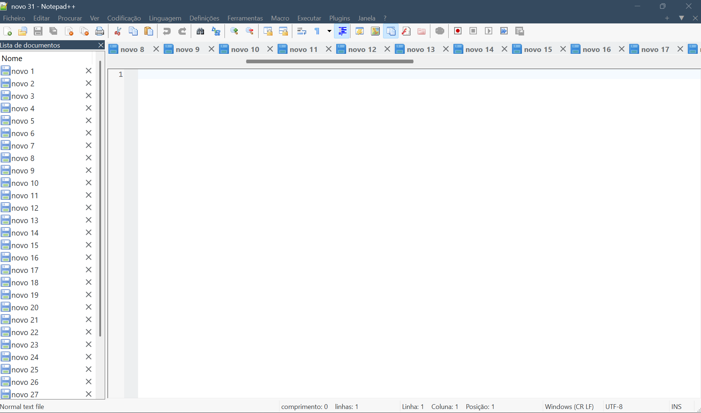

# Notevag++

Versão do Notepad++ com melhorias para trabalhar com muitos documentos abertos e uma interface clara inspirada no Quartz Light.



## O que mudou

- **Rolagem horizontal nas abas:** barra de 24 px, com ajuste de DPI, arraste pelo mouse, roda, Shift + roda e tratamento de eventos horizontais do touchpad.
- **Controles mais fáceis de clicar:** ícones de documento maiores e área de fechamento de até 24 × 24 px, limitada à geometria da aba.
- **Fechamento na Lista de Documentos:** cada linha tem seu próprio `X`, com hover e fechamento pelo fluxo nativo do editor.
- **Botões de fechamento redesenhados:** o mesmo símbolo com antialiasing nas abas e na lista, ajustado ao DPI, com fundo arredondado no hover.
- **Tema Quartz Light:** superfícies claras, cabeçalho azul-acinzentado e acentos roxos. A roupagem se estende a menus, barra de ferramentas, abas, painéis e barra de status.

O fechamento continua usando os mecanismos existentes de salvamento, confirmação e gerenciamento de documentos. A política de backup e restauração de sessões permanece no código original.

## Ativar o tema

Em **Definições → Configurador de Estilos**, selecione **SAP Quartz Light**. A roupagem clara é ativada com esse tema e o modo escuro desativado. O nome do menu pode variar conforme o idioma.

As preferências de abas verticais e de múltiplas linhas continuam disponíveis. A nova barra de rolagem é usada no modo horizontal de linha única.

## Compilar

O código e as dependências de Scintilla, Lexilla e Boost Regex estão no repositório. Siga o [guia de build](BUILD.md) para Visual Studio ou MinGW-w64.

Exemplo com MinGW-w64 no Windows, com as ferramentas no `PATH`:

```powershell
cd PowerEditor/gcc
mingw32-make -j4
```

O executável x64 é gerado em `PowerEditor/gcc/bin.gcc.x86_64/notepad++.exe`, junto dos arquivos de distribuição.

## Validação e limites

A build local x64 compilou com MinGW-w64/GCC. Foram exercitados a abertura de 32 documentos, o arraste da barra de abas e o fechamento pela Lista de Documentos sem ativar o arquivo fechado. O renderizador dos novos botões foi conferido em 100%, 125%, 150% e 200%, com paletas clara e escura; 500 redesenhos mantiveram a mesma contagem de objetos GDI.

Ainda precisam de validação completa: touchpad físico, transição entre temas, documentos modificados, duas visualizações e mudanças de DPI entre monitores. Conferir a renderização dos botões em várias escalas não equivale a validar toda a interface nessas escalas.

A rolagem usa índices de abas do controle Win32, sem deslocamento contínuo por pixel. A cor personalizada da barra de título depende do Windows 11. Diálogos do sistema e interfaces próprias de plugins seguem o desenho desses componentes.

O linker da build local emitiu um aviso de manifests duplicados, sem impedir a geração do executável; o comportamento em outras máquinas ainda deve ser conferido.

## Origem e licença

Derivado do [Notepad++](https://github.com/notepad-plus-plus/notepad-plus-plus), a partir do commit [`816c16d`](https://github.com/notepad-plus-plus/notepad-plus-plus/commit/816c16d). Esta publicação inicial contém o código-base completo e as alterações de interface.

Distribuído sob a [GNU GPL](LICENSE). Os créditos e avisos de copyright do projeto original e das dependências foram preservados.
